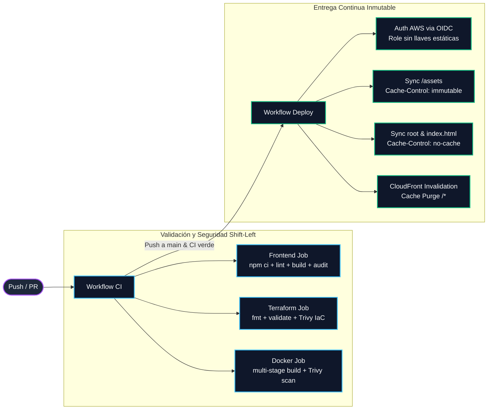

<div align="center">
  <h1>🌌 haz-ops — Cloud & DevOps Infrastructure Portfolio</h1>
  <p><strong>Arquitectura de hosting estático en AWS con Zero-Trust, CDN perimetral e Infraestructura como Código reproducible.</strong></p>

  <p>
    <a href="https://github.com/0xhazroot/haz-ops/actions/workflows/ci.yml"></a>
    <a href="https://www.terraform.io/"></a>
    <a href="https://aws.amazon.com/"></a>
    <a href="https://www.docker.com/"></a>
    <a href="https://react.dev/"></a>
    <a href="./LICENSE"></a>
  </p>

  <p>
    🔗 <strong>Despliegue activo en AWS CloudFront:</strong> <a href="https://d36uh9w4nau2ye.cloudfront.net">https://d36uh9w4nau2ye.cloudfront.net</a>
  </p>
</div>

---

## 📌 Resumen Ejecutivo

Este repositorio resuelve el aprovisionamiento, hardening y entrega continua de una Single Page Application (SPA) de alto rendimiento sobre **Amazon Web Services (AWS)**. Elimina la necesidad de plataformas PaaS de terceros mediante una arquitectura serverless desacoplada, inmutable y declarativa, orquestada mediante **Terraform** y verificada por pipelines de **GitHub Actions** con análisis de seguridad shift-left.

---

## 🏛️ Arquitectura Cloud en AWS

```mermaid
graph TD
    classDef client fill:#1e293b,stroke:#38bdf8,stroke-width:2px,color:#f8fafc;
    classDef edge fill:#0f172a,stroke:#f59e0b,stroke-width:2px,color:#f8fafc;
    classDef storage fill:#0f172a,stroke:#10b981,stroke-width:2px,color:#f8fafc;

    User([Cliente Web]):::client -->|HTTPS / TLSv1.2+| CF[AWS CloudFront CDN<br/>PriceClass_100]:::edge
    
    subgraph Edge Layer [Perímetro y Distribución Global]
        CF --> HP[Response Headers Policy<br/>HSTS + CSP + X-Frame + nosniff]:::edge
        CF --> CP[Managed Cache Policy<br/>CachingOptimized]:::edge
        CF --> ERR{Error 403 / 404?}:::edge
        ERR -->|Rewrite 200 OK| SPA[/index.html<br/>SPA Client Routing]:::edge
    end

    subgraph Storage Layer [Zero-Trust Storage]
        CF -->|Origin Access Control SigV4| S3[(AWS S3 Private Bucket<br/>Public Access Blocked)]:::storage
    end
```

---

## 🔄 Pipeline de Integración y Entrega Continua (CI/CD)



---

## ⚖️ Decisiones de Arquitectura

| Decisión | Alternativa descartada | Justificación técnica |
| :--- | :--- | :--- |
| **Origin Access Control (OAC)** | Origin Access Identity (OAI) | OAC es el estándar moderno de AWS; soporta firmas SigV4, cifrado SSE-KMS y elimina las vulnerabilidades heredadas de OAI. |
| **S3 Private con Public Access Block** | S3 Static Website Hosting público | S3 Website Hosting requiere exponer el bucket a internet público. Con OAC, el bucket permanece estrictamente privado y cerrado a tráfico directo. |
| **CloudFront como Edge Runtime** | Servidor EC2 / Nginx tradicional | Elimina costos fijos y mantenimiento de parches del SO. Ofrece más de 400 puntos perimetrales con compresión y terminación TLS automática. |
| **SPA Fallback con custom_error_response** | Redirecciones 301/302 a nivel aplicación | Redirigir códigos 403/404 originados en S3 hacia `/index.html` con código 200 preserva el historial del navegador y permite que React Router resuelva la ruta en el cliente. |
| **Managed-CachingOptimized Cache Policy** | `forwarded_values` legado de CloudFront | `forwarded_values` está obsoleto por AWS. La política administrada estandariza TTLs y respeta las cabeceras `Cache-Control` inyectadas por el pipeline. |
| **force_destroy activado en S3** | `force_destroy = false` | El portafolio es un entorno efímero e indexable. Permitir vaciado automático evita bloqueos manuales al destruir y reaplicar la infraestructura en entornos de laboratorio. |
| **Estado Local con Backend Example** | Backend S3 + DynamoDB aplicado de inmediato | Para un despliegue individual de inicio, el estado local no requiere provisionar infraestructura auxiliar. Se dejó preparado y documentado el template de migración remota para trabajo en equipo. |
| **OIDC para GitHub Actions** | AWS Access Keys de larga duración | Los tokens OIDC federados (JWT) eliminan credenciales estáticas en secretos de GitHub, reduciendo la superficie de ataque ante filtraciones. |
| **Docker como Preview y Validación en CI** | Docker como runtime productivo | El runtime óptimo para contenido estático es S3 + CDN. Docker se utiliza para garantizar builds idénticos entre entornos y validar la portabilidad en contenedores. |

---

## 🛡️ Seguridad y DevSecOps

El repositorio adopta el principio de mínimo privilegio y verificación temprana:

- **Aislamiento S3:** `BlockPublicAcls`, `BlockPublicPolicy`, `IgnorePublicAcls` y `RestrictPublicBuckets` en `true`. Política de bucket condicionada por `AWS:SourceArn` exacto de la distribución CloudFront.
- **Cabeceras de Endurecimiento HTTP:** Política administrada adjunta a CloudFront inyectando `HSTS` (1 año + preload), `X-Frame-Options: DENY`, `X-Content-Type-Options: nosniff`, `Referrer-Policy: strict-origin-when-cross-origin` y `Content-Security-Policy`.
- **Contenedor no privilegiado:** `Dockerfile` basado en `nginxinc/nginx-unprivileged:1.27-alpine` corriendo en puerto 8080 bajo el usuario `nginx` (UID 101), sin capacidades root.
- **Escaneo estático en CI:** Inspección automatizada de vulnerabilidades y configuraciones inseguras con **Trivy** en manifiestos de Terraform e imágenes de contenedor.
- **Gestión de dependencias:** Dependabot activo semanalmente para `npm`, `github-actions`, `docker` y `terraform`.

---

## 📂 Estructura del Repositorio

```text
haz-ops/
├── .github/
│   ├── dependabot.yml           # Actualizaciones automáticas agrupadas por ecosistema
│   └── workflows/
│       ├── ci.yml               # Pipeline de validación (lint, build, audit, tf, docker)
│       └── deploy.yml           # Pipeline de entrega a AWS autenticado por OIDC
├── docs/                        # Documentación técnica adicional y arquitectura
├── scripts/
│   └── deploy.sh                # Script de despliegue manual basado en outputs de Terraform
├── src/                         # Código fuente de la Single Page Application (React 19)
├── terraform/
│   ├── backend.tf.example       # Plantilla de migración hacia S3 + DynamoDB locking
│   ├── iam-oidc.tf              # Configuración opcional de IAM OIDC para GitHub Actions
│   ├── main.tf                  # Recursos base: S3, OAC, CloudFront, Response Headers
│   ├── outputs.tf               # Outputs de conexión: bucket name, distribution id, URL
│   ├── provider.tf              # Declaración de providers (AWS ~> 5.0, Random ~> 3.0)
│   ├── README.md                # Guía operativa de infraestructura
│   └── variables.tf             # Variables parametrizadas con validaciones
├── Dockerfile                   # Build multi-stage unprivileged (Node 22 + Nginx)
├── Makefile                     # Acceso rápido a comandos de desarrollo y operaciones
├── docker-compose.yml           # Perfiles dev (hot-reload) y prod (preview local)
├── nginx.conf                   # Configuración de Nginx para SPA fallback y seguridad
└── package.json                 # Dependencias estrictas de frontend (sin SDKs sobrantes)
```

---

## 🚀 Inicio Rápido (Quick Start)

### Prerrequisitos
- **Node.js:** `>= 22.0.0` y **npm:** `>= 10.0.0`
- **Terraform:** `>= 1.5.0`
- **AWS CLI:** `v2` configurado con permisos sobre S3 y CloudFront

<details>
<summary><strong>Paso 1: Aprovisionar Infraestructura en AWS</strong></summary>

```bash
cd terraform

# Inicializar proveedores declarados
terraform init

# Generar y revisar plan binario de ejecución
terraform plan -out=tfplan

# Aplicar infraestructura de forma determinista
terraform apply tfplan

# Consultar los endpoints resultantes
terraform output
```
</details>

<details>
<summary><strong>Paso 2: Compilación y Despliegue del Frontend</strong></summary>

```bash
# Desde la raíz del repositorio
npm ci
npm run build

# Despliegue automatizado con el script operativo
bash scripts/deploy.sh
```
</details>

<details>
<summary><strong>Paso 3: Ejecución Local con Docker Compose</strong></summary>

```bash
# Modo desarrollo con Hot-Reload (puerto 5173)
docker compose --profile dev up

# Previsualización de producción idéntica a Nginx (puerto 8080)
docker compose --profile prod up --build
```
</details>

> 💡 **Nota sobre costes:** La infraestructura opera dentro de la capa gratuita permanente de AWS (CloudFront incluye 1 TB de transferencia saliente mensual y S3 5 GB durante el primer año). El coste residual estimado para tráfico de portafolio es de **$0.00 USD/mes**.

---

## 🛠️ Stack Tecnológico

| Área | Tecnologías | Propósito |
| :--- | :--- | :--- |
| **Cloud** | AWS S3, CloudFront, OAC | Almacenamiento Zero-Trust y red perimetral de entrega global |
| **IaC** | Terraform `>= 1.5.0`, HashiCorp AWS & Random | Infraestructura inmutable y declarativa |
| **CI/CD** | GitHub Actions, Trivy, Dependabot | Automatización, escaneo de seguridad y gestión de parches |
| **Contenedores** | Docker, Nginx Unprivileged, Compose Profiles | Entornos reproducibles y previsualización local |
| **Frontend** | React 19, Vite 8, Framer Motion, Canvas API | Aplicación SPA de alto rendimiento visual |

---

## 🗺️ Roadmap de Mejoras

- [ ] **Migración de Estado a Backend Remoto:** Provisionar bucket S3 con cifrado y DynamoDB para bloqueo de concurrencia (`terraform-locks`).
- [ ] **Multi-Ambiente con Workspaces:** Parametrizar ramas para separar entornos `staging` y `production`.
- [ ] **Dominio Personalizado:** Incorporar zona en Route53 y certificado SSL público administrado por AWS Certificate Manager (ACM).
- [ ] **WAF (Web Application Firewall):** Añadir reglas de mitigación de peticiones anómalas y Rate Limiting en CloudFront.
- [ ] **Observabilidad Perimetral:** Habilitar CloudFront Standard Access Logs dirigidos a S3 y dashboards de métricas en CloudWatch.

---

## 💡 Lecciones Aprendidas

1. **La seguridad en la nube empieza por la arquitectura:** Configurar S3 con bloqueo total de acceso público y exigir firmas SigV4 mediante OAC previene la fuga involuntaria de datos por configuraciones erróneas en permisos de bucket.
2. **Docs-as-Code garantiza sincronía real:** Mantener la documentación técnica, los diagramas y los runbooks en el mismo repositorio Git asegura que las decisiones arquitectónicas evolucionen a la par del código fuente.
3. **El rol de Docker en arquitecturas serverless:** En aplicaciones estáticas, el contenedor no es el runtime productivo final, sino la herramienta que garantiza compilaciones reproducibles e independientes del sistema operativo del desarrollador.

---

## 👤 Autor

**Samir Haziel (`0xhazroot`)**  
*Cloud & DevOps Platform Engineer*  
- **GitHub:** [https://github.com/0xhazroot](https://github.com/0xhazroot)  
- **Portfolio Live:** [https://d36uh9w4nau2ye.cloudfront.net](https://d36uh9w4nau2ye.cloudfront.net)
