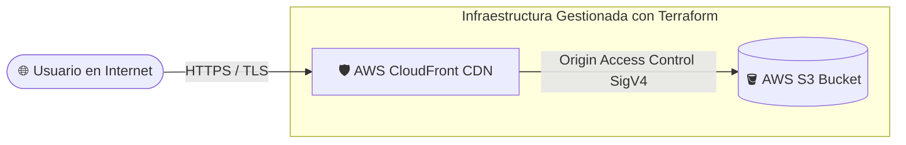

<div align="center">
  

  <br />
  <br />

  <h1>🌌 Samir Haziel — Cloud & DevOps Engineer Portfolio</h1>
  
  <p>
    <strong>Arquitectura Cloud Resiliente • Infraestructura como Código (IaC) • CI/CD & DevSecOps</strong>
  </p>

  <p>
    <a href="https://reactjs.org/"></a>
    <a href="https://vitejs.dev/"></a>
    <a href="https://aws.amazon.com/"></a>
    <a href="https://www.terraform.io/"></a>
    <a href="https://vercel.com/"></a>
  </p>
</div>

---

## ⚡ Sobre el Proyecto

Este repositorio contiene la arquitectura y el código fuente de mi **Portafolio Profesional** como Cloud & DevOps Engineer. Diseñado con una experiencia inmersiva y moderna en el frontend, y respaldado por prácticas sólidas de ingeniería de infraestructura en la nube.

---

## ☁️ Arquitectura Cloud en AWS (Infraestructura como Código con Terraform)

El proyecto incluye una arquitectura estandarizada en AWS contenida en el directorio [`/terraform`](./terraform), implementada con principios de **Zero-Trust** y alta disponibilidad:



### 🔒 Pilares de la Arquitectura AWS:
1. **AWS S3 (Almacenamiento Estático):** Alojamiento de los artefactos compilados de la SPA (`dist/`). El bucket tiene **bloqueo total de acceso público** activado (`BlockPublicAcls = true`, `BlockPublicPolicy = true`).
2. **AWS CloudFront (CDN Perimetral):** Distribuye el contenido a través de más de 400 puntos de presencia globales (Edge Locations) con compresión Gzip/Brotli y certificado SSL automático.
3. **Origin Access Control (OAC):** Mecanismo de seguridad de última generación de AWS que autentica cada petición entre CloudFront y S3 mediante firmas criptográficas SigV4, garantizando que nadie pueda evadir la CDN ni acceder directamente al bucket.
4. **Manejo de Errores SPA:** Respuestas de error personalizadas para redirigir códigos 403/404 hacia `/index.html` con código HTTP 200, permitiendo enrutamiento fluido en el cliente.

> 📖 *Para ver la guía paso a paso de inicialización (`terraform init`, `plan`, `apply`), consulta [terraform/README.md](./terraform/README.md).*

---

## 🛠️ Stack Tecnológico

| Área | Tecnologías |
| :--- | :--- |
| **Cloud Computing** | ☁️ AWS (S3, CloudFront, OAC, IAM, Route53), ⚡ Vercel Edge Network |
| **Infraestructura como Código (IaC)** | 🏗️ Terraform (HCL), Módulos reutilizables |
| **Contenedores & Orquestación** | 🐋 Docker, Docker Compose, ☸️ Kubernetes |
| **Automatización & CI/CD** | 🤖 GitHub Actions, Dependabot |
| **Frontend & UI Engine** | ⚛️ React 19, ⚡ Vite 8, 🎬 Framer Motion, 🎨 Canvas API (Nodos 3D) |

---

## 🚀 Despliegue

### 1. Despliegue en la Nube (AWS con Terraform)
```bash
cd terraform
terraform init
terraform plan
terraform apply
```

### 2. Despliegue Rápido (Vercel)
El proyecto está preconfigurado con [`vercel.json`](./vercel.json) para despliegues instantáneos desde GitHub con soporte SPA y optimización de caché.

### 3. Ejecución Local (Desarrollo)
```bash
# Instalar dependencias
npm install

# Iniciar servidor local
npm run dev
```

---

## 🤖 Mantenimiento & Automatización

- **Dependabot:** Actualizaciones de seguridad automáticas semanales para dependencias npm y providers de Terraform.
- **Auditoría de dependencias:** Verificación continua de vulnerabilidades en librerías de producción.
